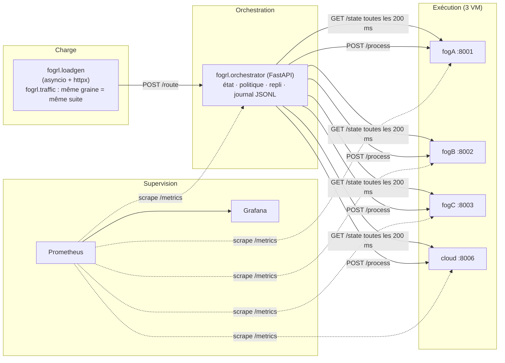

# Architecture

Trois couches, comme dans le CDC §5.1 : **génération de charge**, **orchestration** (c'est elle qui décide) et **exécution**
(nœuds fog et cloud). Le même code de politiques, de trafic, d'énergie et de récompense est utilisé par le simulateur et par le
prototype réel ; seules les couches « monde » (nœuds simulés / vrais workers HTTP) diffèrent.

## 1. Paquets Python (`fogrl/`)

| Paquet | Rôle | Exigences |
|---|---|---|
| `state_spec.py`, `config.py`, `reward.py`, `traffic.py`, `metrics.py`, `utils.py` | Contrat d'observation, configurations YAML typées, récompense, générateurs de trafic, métriques d'épisode, graines | EF-02, EF-06, ENF-07 |
| `sim/` | `FogEnv` (Gymnasium), `NodeSim` (files FIFO multi-serveurs, énergie, batterie, pannes), modèles de service paramétrique ou calibré | OS-2 |
| `policies/` | Interface commune, 5 baselines, politique RL (SB3), fabrique `make_policy` | EF-08, OS-4 |
| `training/` | Entraînement DQN/PPO/A2C par niveaux, test N0 (`sanity`), Optuna (`tune`), ablation des poids | OS-3, ENF-05 |
| `evaluation/` | Matrices d'expériences, statistiques (intervalles de confiance, test de Mann-Whitney), figures, rapport de recette, comparaison sim/réel | OS-4, ENF-02/03, OS-7 |
| `worker/` | Nœud fog ou cloud : `/process`, `/state`, `/metrics`, machine à états, exécuteur de processus, charges `burn` / `real` / ONNX | OS-5, EF-04 |
| `orchestrator/` | Sondage des nœuds, moteur de décision à budget, repli, disjoncteurs, hot-swap, journal, métriques | EF-01, 03, 05, 07, 09, ENF-01 |
| `loadgen/` | Générateur asynchrone et campagnes (CSV de même schéma que la simulation) | EF-06, OS-7 |
| `calibration/` | Mesures sur les nœuds et ajustement du modèle de service | OS-2 |
| `deploy/` | Génération des fichiers Compose, Prometheus et Grafana ; pile locale sans Docker | OS-5, OS-6 |

## 2. Worker (un nœud)

- **API** : `GET /health`, `GET /info`, `GET /state` (file, CPU, in_flight, batterie, disponibilité), `POST /process`, `GET /metrics`,
  et `POST /admin/fail|recover|reset` pour l'injection de pannes.
- **Machine à états** (`NodeRuntime`) : mêmes équations que `NodeSim` pour la file, l'énergie linéaire et la batterie
  virtuelle (`fogrl/sim/energy.py` est partagé). `/state` publie l'attente estimée, la charge CPU lissée et les requêtes en cours.
- **Exécution** : un serveur = un processus (D8). Charges : `burn` (CPU occupé pendant `work_ms` de temps CPU, par défaut),
  `real` (vrais calculs numpy et inférence ONNX MobileNetV2 pour la requête lourde si `ONNX_MODEL` est fourni, sinon calcul matriciel).
- **Réponse de `/process`** : `node`, `request_id`, `type`, `work_ms`, `wait_ms`, `service_ms`, `load` (fraction de serveurs
  occupés à l'arrivée), `energy_j`, `cost`, `battery_fraction`. File pleine → 429 ; nœud en panne → 503.
- **Réglages** (variables d'environnement) : `NODE_ID`, `NODES_FILE`, `PORT`, `WORKER_MODE`, `WORKER_EXECUTOR`,
  `EMULATE_SPEED`, `SIMULATED_RTT_MS`, `ONNX_MODEL`.

## 3. Orchestrateur

- **API** : `POST /route` (`{"type": "light|medium|heavy", "work_ms": 5, "deadline_ms": 100?, "request_id"?}`), `GET /state`,
  `GET /nodes[?fresh=true]`, `GET|POST /policy`, `GET /metrics`, `GET /health`, `POST /admin/reset`,
  `POST /admin/nodes/{id}/{fail|recover}` (panne d'un nœud), `POST /admin/policy-fault` (panne ou lenteur de l'agent, test EF-07).
- **Chemin d'une requête** : (1) lecture de l'état sondé (200 ms) et du compteur `in_flight` frais ; (2) décision sous budget de
  20 ms ; (3) `POST /process` sur le nœud choisi (file pleine, panne ou délai dépassé = rejet avec sa raison, sans nouvel essai ; aucun nœud disponible = rejet `no_node_available`) ; (4) calcul de la latence de bout en bout, journalisation
  JSONL (horodatage, état, action, politique, temps de décision, latence, énergie, repli) et métriques Prometheus.
- **Résilience** : repli Least-connections (budget dépassé, exception, observation invalide, action invalide), disjoncteur de
  politique, disjoncteur par nœud, hot-swap avec contrôle de contrat et préchauffage (voir D11).
- **Réglages** : `configs/deploy/orchestrator.yaml`, surchargeables par `ORCH_CONFIG`, `ORCH_ENV_FILE`, `ORCH_POLICY`,
  `ORCH_CONFIGURATION`, `ORCH_NODE_URLS` (`fogA=http://ip:8001,…`), `DECISION_LOG`.
- **Politique** : `least_connections`, `greedy`, … ou `rl:models/n3/ppo/seed0` ; changement à chaud :
  `curl -X POST :9000/policy -H 'content-type: application/json' -d '{"spec": "rl:models/n3/ppo/seed0", "name": "ppo"}'`.

## 4. Métriques Prometheus

| Source | Familles |
|---|---|
| Orchestrateur | `fog_route_requests_total`, `fog_route_deadline_missed_total`, `fog_route_latency_seconds`, `fog_decision_seconds`, `fog_decision_fallback_total`, `fog_route_energy_joules_total`, `fog_route_cost_total`, `fog_orchestrator_arrival_rate_rps`, `fog_policy_info`, `fog_policy_breaker_open`, `fog_monitor_{node_up,rtt_ms,queue_ms,cpu_load,battery_fraction,in_flight}` |
| Worker | `fog_node_{queue_ms,cpu_load,in_flight,up,battery_fraction,energy_joules_total}`, `fog_worker_{requests_total,service_seconds,wait_seconds}` |

Le tableau de bord Grafana (`deploy/grafana/dashboards/fog-rl.json`, livrable L6) est généré par `fogrl/deploy/dashboard.py` ;
`tests/test_deploy.py` vérifie que chaque métrique qu'il interroge existe dans l'exposition réelle du worker et de l'orchestrateur.
cAdvisor et node-exporter (CDC §5.4) ne sont **pas** inclus : les métriques de nœud viennent des workers eux-mêmes.

## 5. Topologies de déploiement

| Mode | Commande | Usage |
|---|---|---|
| Sans Docker, une machine | `make local-smoke` ou `python scripts/local_stack.py` | essai du prototype, CI ; vitesse et RTT émulés par l'application (D9) |
| Docker Compose, une machine | `python scripts/gen_compose.py` puis `bash scripts/deploy.sh local up` | démonstration complète avec Prometheus et Grafana ; limites cgroups et `tc netem` |
| 3 VM | `python scripts/gen_compose.py --hosts vm1=IP1,vm2=IP2,vm3=IP3` puis `bash scripts/deploy.sh vm1\|vm2\|vm3\|control up` | cible du CDC ; voir [`runbook.md`](runbook.md) |

Répartition des nœuds par VM (colonne `vm` de `configs/nodes/pool6.yaml`) : vm1 = fogA + fogB (+ fogD en n6), vm2 = fogC
(+ fogE en n6), vm3 = cloud. L'orchestrateur, Prometheus, Grafana et le générateur de charge tournent sur la VM de contrôle ;
par défaut, il s'agit de vm3 (`compose.control.yml`). Les limites `cpus` des profils s'additionnent : en n4, vm1 demande
1,5 vCPU, vm2 demande 2 vCPU et vm3 demande 4 vCPU pour cloud, auxquels il faut ajouter les ressources du contrôle. Le générateur
affiche un avertissement si les limites des workers dépassent la capacité indiquée (`--vm-cpus`).

## 6. Fidélité simulation / réel

Le simulateur et le prototype partagent : les profils de nœuds (`pool6.yaml`), les types de requêtes, la normalisation, la récompense,
les générateurs de trafic et les politiques. La campagne réelle (`fogrl.loadgen.campaign`) écrit un CSV de **mêmes colonnes** que
`fogrl.evaluation.experiments` (+ `source: real`), de sorte que `fogrl.evaluation.compare` vérifie directement ENF-08 :
écart de latence moyenne < 20 % et même classement des politiques.
