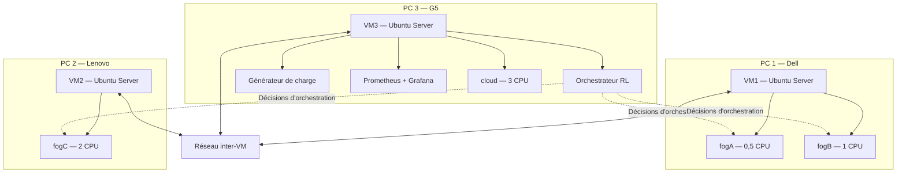

# Infrastructure du banc d’essai
### Projet : Orchestration dynamique des nœuds Fog avec Reinforcement Learning

> **Dernière mise à jour :** 11 octobre 2026  
> **Version :** P2  
> **Objectif :** Décrire l’infrastructure matérielle et logicielle, la configuration réseau et les procédures de validation du banc d’essai.

---

---

## 1. Infrastructure matérielle

Le banc d’essai repose sur trois ordinateurs physiques hétérogènes. Chaque ordinateur héberge une machine virtuelle Ubuntu Server dédiée à une partie de l’infrastructure.

| PC | Modèle | Processeur | Cœurs / threads | RAM utilisable | Système |
|:---|:---|:---|:---:|---:|:---|
| Dell | Vostro 3520 | Intel Core i3-1215U | 6 / 8 | 15,7 Go | Windows 11 Pro |
| Lenovo | IdeaPad 3 15ALC6 | AMD Ryzen 5 5500U | 6 / 12 | 17,8 Go | Windows 11 Famille |
| G5 | G5 KF5 | Intel Core i7-13620H | 10 / 16 | 15,7 Go | Windows 11 Pro |

### Connectivité physique

| PC | Ethernet | Wi-Fi mesuré |
|:---|:---|---:|
| Dell | Port présent, non connecté | 65 Mbps |
| Lenovo | Adaptateur USB-Ethernet nécessaire | 144 Mbps |
| G5 | Port présent, non connecté | 1,3 Gbps |

---

## 2. Environnement logiciel

*État relevé le 11 octobre 2026.*

| PC | Distribution WSL2 | Docker Desktop | Hyperviseur Windows |
|:---|:---|:---:|:---:|
| Dell | Ubuntu 24.04 | 4.83.0 | Actif |
| Lenovo | Ubuntu | 4.94.0 | Actif |
| G5 | Ubuntu | 4.59.0 | Actif |

### Points de vigilance

- **Docker Desktop :** arrêter les conteneurs et l’environnement Docker Desktop pendant les mesures réalisées dans les VM.
- **Virtualisation matérielle :** la valeur `VirtualizationFirmwareEnabled = False` relevée sur le Dell et le G5 doit être vérifiée. L’activité de l’hyperviseur Windows ne suffit pas, à elle seule, à confirmer que la virtualisation matérielle est correctement configurée pour VirtualBox.
- **Hyperviseur :** VirtualBox est le choix envisagé, sous réserve de tests de compatibilité. VMware Workstation constitue une alternative.

---

## 3. Architecture retenue

### 3.1 Principes

- Une machine virtuelle **Ubuntu Server 24.04 LTS** par ordinateur physique.
- Les nœuds Fog sont exécutés dans des conteneurs Docker.
- L’orchestrateur, le générateur de charge et les outils de supervision sont hébergés sur la troisième VM.
- Les trois VM communiquent par le réseau entre les ordinateurs physiques.
- Les ressources CPU et les délais réseau sont contrôlés afin de reproduire des profils de nœuds différents.

### 3.2 Vue d’ensemble

> **Remarque :** ce diagramme représente l’architecture cible. Les connexions et les adresses IP devront être confirmées lors des tests réseau.

---

## 4. Configuration des machines virtuelles

| Paramètre | VM1 | VM2 | VM3 |
|:---|:---|:---|:---|
| PC hôte | Dell | Lenovo | G5 |
| vCPU | 3 | 4 | 4 à 6 |
| RAM | 6 Go | 6 à 8 Go | 8 Go |
| Disque | 25 Go | 25 Go | 30 Go |
| Adresse IP | À définir | À définir | À définir |
| Rôle principal | Nœuds Fog | Nœud Fog | Orchestration et supervision |
| Conteneurs | fogA, fogB | fogC | Orchestrateur, charge, supervision, cloud |

### Règle d’allocation CPU

La somme des limites CPU des conteneurs d’une VM doit rester inférieure ou égale à :

`vCPU de la VM − 0,5 CPU`

Cette marge est destinée à limiter la saturation de la VM et à conserver des ressources pour le système invité.

**Exemple :** pour une VM de 3 vCPU, la somme des limites CPU des conteneurs ne doit pas dépasser 2,5 CPU.

---

## 5. Profils des nœuds

Les profils ci-dessous définissent les ressources disponibles, la concurrence et les paramètres réseau et énergétiques utilisés dans les expériences.

| Nœud | Limite CPU | Concurrence | Vitesse relative | Délai netem | P_idle / P_max | Batterie | VM |
|:---|---:|---:|---:|:---:|:---:|:---:|:---|
| fogA | 0,5 | 1 | 1,0 | 5 ± 1 ms | 2,7 / 6,4 W | Oui | VM1 |
| fogB | 1,0 | 1 | 1,0 | 10 ± 2 ms | 5 / 15 W | Oui | VM1 |
| fogC | 2,0 | 2 | 1,5 | 20 ± 3 ms | 10 / 35 W | Non | VM2 |
| cloud | 3,0 | 4 | 2,0 | 80 ± 10 ms | Coût par requête | Non | VM3 |
| fogD | À définir | À définir | À définir | À définir | À définir | À définir | À définir |
| fogE | À définir | À définir | À définir | À définir | À définir | À définir | À définir |

**Interprétation des paramètres :**

- **Limite CPU :** quantité maximale de CPU attribuée au conteneur.
- **Concurrence :** nombre de tâches ou requêtes traitées simultanément.
- **Vitesse relative :** coefficient de performance à calibrer expérimentalement.
- **Délai netem :** délai configuré sur le trafic sortant du conteneur.
- **P_idle / P_max :** puissance énergétique modélisée au repos et en charge, exprimée en watts.
- **Batterie :** indique si le profil représente un nœud alimenté par batterie.

> **Attention au délai réseau :** un délai configuré dans un seul sens ne correspond pas automatiquement à la même augmentation du RTT. Le délai aller-retour doit être mesuré et validé expérimentalement.

### Contraintes d’affectation

- Un nœud reste sur la même VM pendant une série de mesures.
- Les profils CPU doivent être calibrés sur la machine physique qui les héberge.
- Les paramètres de vitesse et d’énergie sont des hypothèses expérimentales à documenter et à valider.
- Les profils fogD et fogE seront définis pour les expériences utilisant six nœuds.

---

## 6. Configuration et mesures réseau

### 6.1 Liaison réseau

| Paramètre | Configuration |
|:---|:---|
| Liaison utilisée actuellement | Wi-Fi — provisoire |
| Liaison cible | Ethernet via switch |
| Adaptateur USB-Ethernet | Nécessaire pour le Lenovo |
| Alternative | Tailscale ou ZeroTier |
| Adresse IP des VM | À relever |
| Synchronisation temporelle | Chrony à vérifier |

### 6.2 Mesures à effectuer

| Mesure | Résultat | Statut |
|:---|:---|:---|
| RTT VM1 ↔ VM2 | À mesurer | À faire |
| RTT VM1 ↔ VM3 | À mesurer | À faire |
| RTT VM2 ↔ VM3 | À mesurer | À faire |
| Débit iperf3 VM1 ↔ VM2 | À mesurer | À faire |
| Débit iperf3 VM1 ↔ VM3 | À mesurer | À faire |
| Débit iperf3 VM2 ↔ VM3 | À mesurer | À faire |
| Décalage d’horloge — `chronyc tracking` | À mesurer | À faire |

Les résultats devront être relevés dans les conditions réelles de mesure, en précisant le type de liaison utilisé.

---

## 7. Tests de faisabilité

Les tests suivants permettent de vérifier que les mécanismes de limitation CPU, d’émulation réseau et de communication inter-VM fonctionnent correctement.

| Test | Environnement | Résultat attendu | Statut |
|:---|:---|:---|:---|
| Limitation `--cpus=0.5` | Dell — Docker Desktop | Plafond proche de 50 % d’un CPU logique selon la charge et l’outil de mesure | Fonctionne, valeur à consigner |
| `netem delay 50ms` | Dell — Docker Desktop | Augmentation mesurée cohérente avec le délai configuré | Fonctionne, mesures à consigner |
| Limitation CPU dans VM1 | Ubuntu Server | Limite CPU respectée | À tester |
| Émulation réseau dans VM1 | Ubuntu Server | Délai validé par mesure | À tester |
| Limitation CPU dans VM2 | Ubuntu Server | Limite CPU respectée | À tester |
| Émulation réseau dans VM2 | Ubuntu Server | Délai validé par mesure | À tester |
| Limitation CPU dans VM3 | Ubuntu Server | Limite CPU respectée | À tester |
| Émulation réseau dans VM3 | Ubuntu Server | Délai validé par mesure | À tester |
| Joignabilité entre les trois VM | Réseau inter-PC | Communication confirmée | À tester |

### Fiche de relevé des tests

Pour chaque test, conserver :

- la date et l’heure ;
- le PC et la VM concernés ;
- la commande exécutée ;
- la configuration avant le test ;
- les mesures avant et après ;
- le résultat observé ;
- les éventuelles anomalies.

---

## 8. Protocole de mesure

Les règles suivantes doivent être respectées à chaque série expérimentale.

### Avant chaque série

- [ ] Brancher les trois ordinateurs sur secteur.
- [ ] Activer le profil d’alimentation « Performances élevées », s’il est disponible.
- [ ] Fermer les applications consommatrices de ressources.
- [ ] Arrêter les conteneurs et services Docker Desktop concurrents.
- [ ] Vérifier la synchronisation des horloges avec `chronyc tracking`.
- [ ] Vérifier la connectivité et la configuration réseau.
- [ ] Consigner les versions logicielles et les paramètres utilisés.

### Pendant chaque série

- [ ] Utiliser l’horloge de l’orchestrateur comme référence temporelle.
- [ ] Calibrer un nœud à la fois sur la VM qui l’héberge.
- [ ] Conserver les mêmes conditions de test pour les politiques d’orchestration comparées.
- [ ] Enregistrer les métriques et les erreurs.
- [ ] Sign